# 🚐 Sistema de Gestión de Padrón Vehicular

Sistema integral para la administración, fiscalización y control documental del **padrón vehicular de asociaciones de transporte público** (mototaxis, motofurgones y unidades autorizadas).

Permite mantener un padrón depurado, gestionar propietarios y conductores, controlar vencimientos (SOAT/AFOCAT, CITV, licencias y curso vial), administrar la cartelera institucional y operar con trazabilidad completa mediante auditoría inmutable.

<p align="center">
  
  
  
  
  
  
  
</p>

> ⚠️ **Estado del proyecto:** aplicación funcional en fase de consolidación. La autenticación actual es de tipo *demo/dev* (ver [Seguridad](#-seguridad)). Antes de un despliegue público con datos reales debe implementarse autenticación real con contraseñas hasheadas.

---

## 📑 Tabla de contenido

- [¿Qué es?](#-qué-es)
- [Capturas](#-capturas)
- [Módulos](#-módulos)
- [Stack tecnológico](#-stack-tecnológico)
- [Arquitectura](#-arquitectura)
- [Estructura del proyecto](#-estructura-del-proyecto)
- [Requisitos](#-requisitos)
- [Instalación rápida](#-instalación-rápida)
- [Variables de entorno](#-variables-de-entorno)
- [Scripts disponibles](#-scripts-disponibles)
- [Base de datos y migraciones](#-base-de-datos-y-migraciones)
- [Pruebas de API (Bruno)](#-pruebas-de-api-bruno)
- [Despliegue](#-despliegue)
- [Seguridad](#-seguridad)
- [Roadmap](#-roadmap)
- [Documentación](#-documentación)
- [Contribuir](#-contribuir)
- [Licencia](#-licencia)

---

## 🎯 ¿Qué es?

El sistema resuelve el ciclo de vida completo de una unidad de transporte:

1. **Alta** de vehículo y propietario(s).
2. **Asignación / reasignación / intercambio** de número de padrón sin romper el historial.
3. **Control documentario** de SOAT/AFOCAT, CITV, licencia de conducir y curso vial.
4. **Fiscalización** con alertas de vencimiento y semaforización.
5. **Baja / retiro** de unidades con motivo, fecha y usuario responsable.
6. **Auditoría** de cada cambio sobre los datos.

Además incluye un **portal institucional** (cartelera, comunicados y agenda), un **portal del operario** con captura de fotos en vivo y módulos de **importación/exportación** en PDF y Excel.

---

## 📸 Capturas

> Las capturas se encuentran en [`docs/screenshots/`](docs/screenshots/). Si acabas de clonar el repositorio y aún no existen, consulta [docs/screenshots/README.md](docs/screenshots/README.md).

| Módulo | Captura |
| :--- | :--- |
| Inicio de sesión | 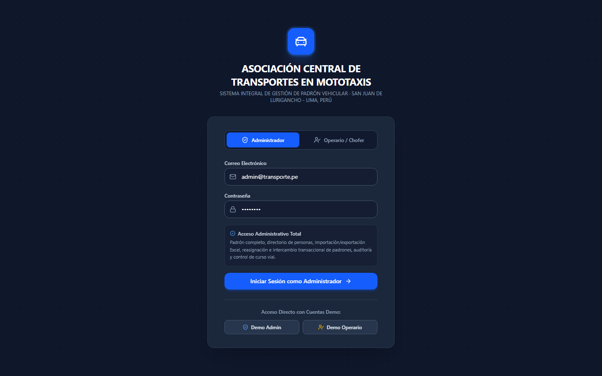 |
| Portal institucional | 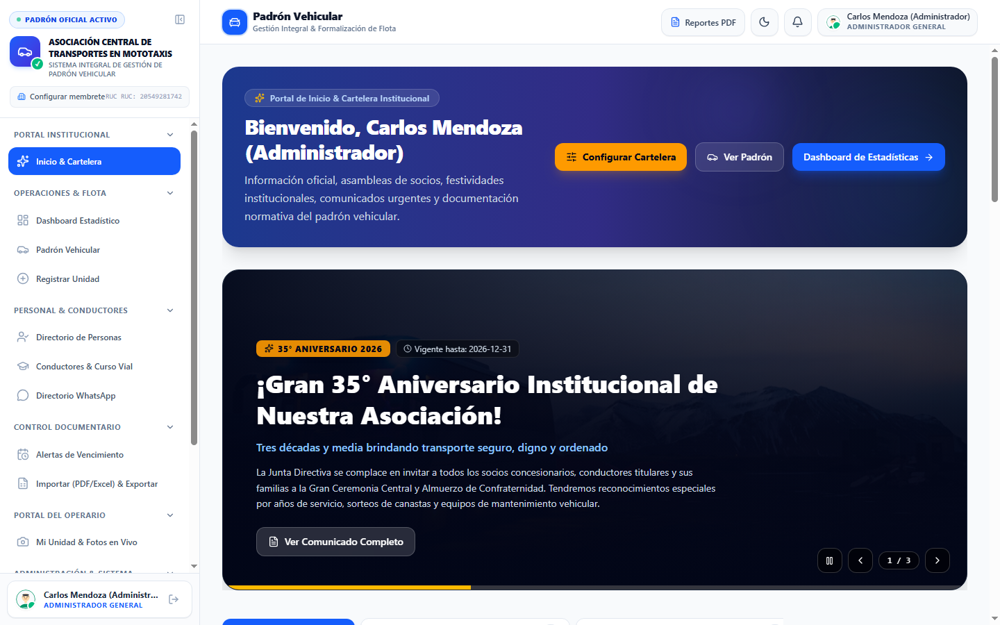 |
| Dashboard estadístico | 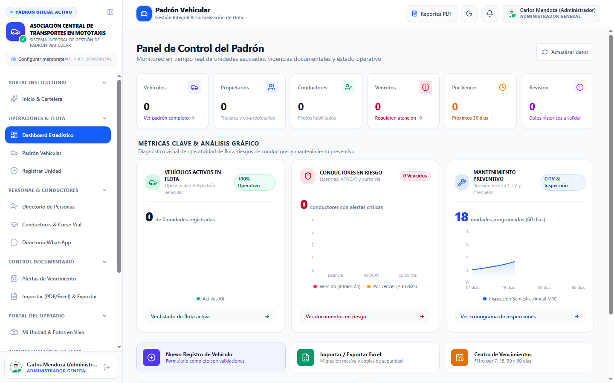 |
| Padrón vehicular | 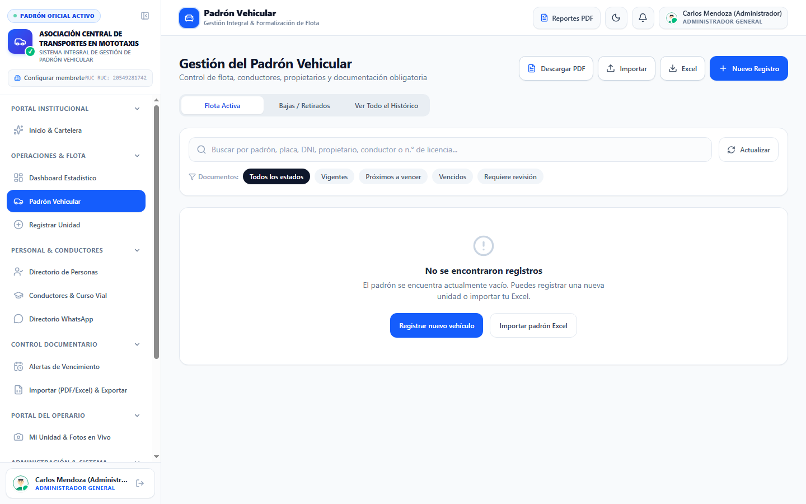 |
| Directorio de personas | 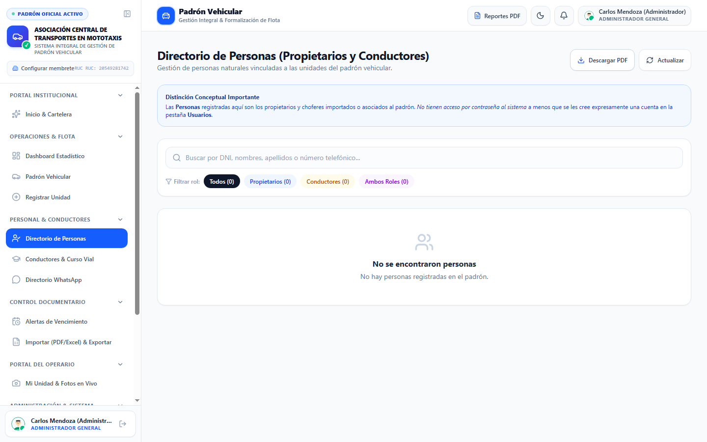 |
| Conductores y curso vial | 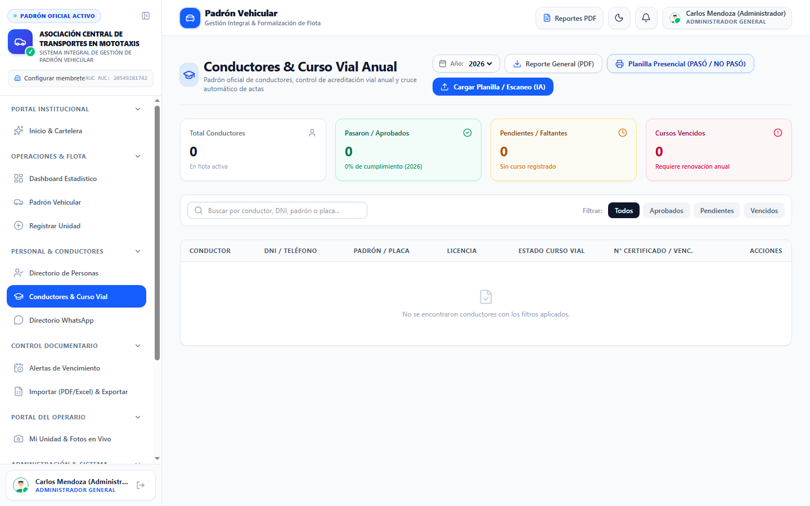 |
| Alertas de vencimiento | 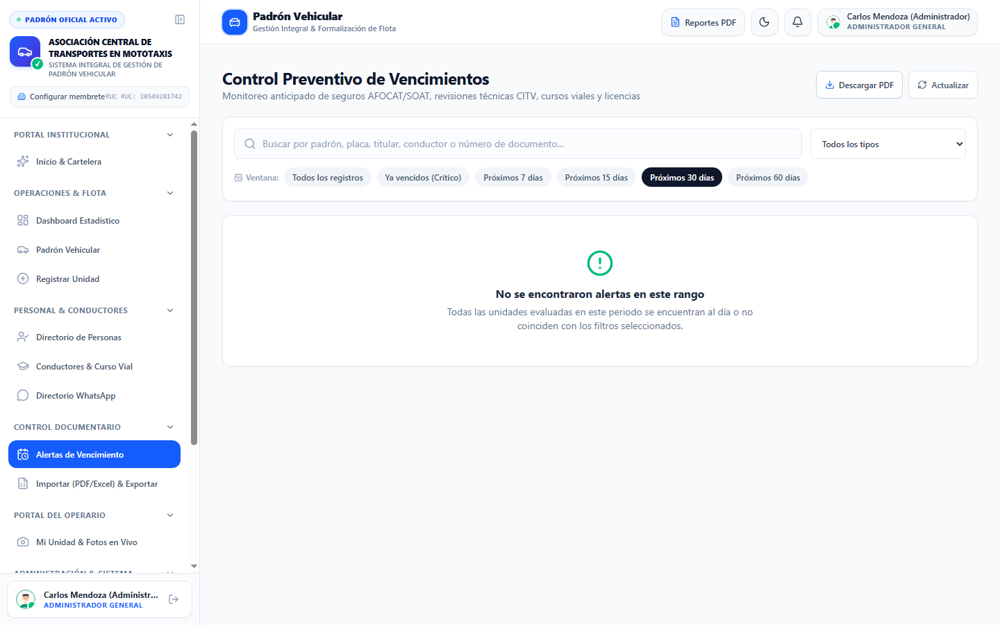 |
| Importar / Exportar | 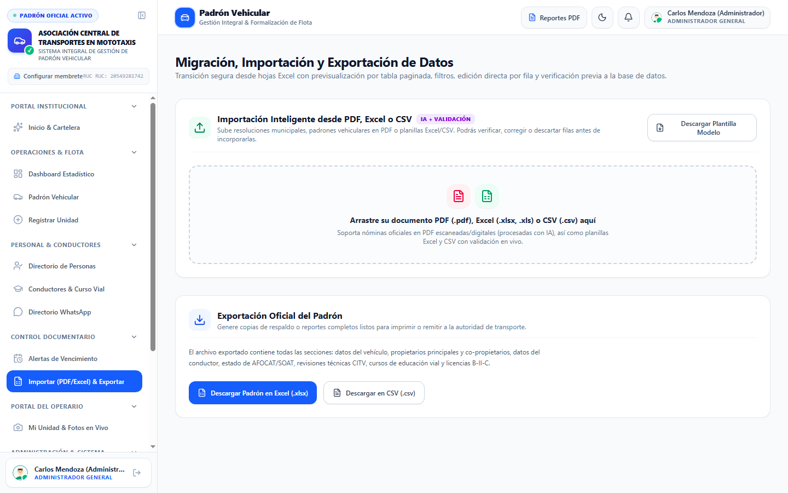 |
| Portal del operario | 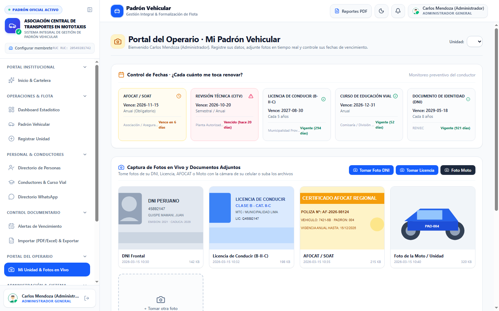 |
| Historial de auditoría | 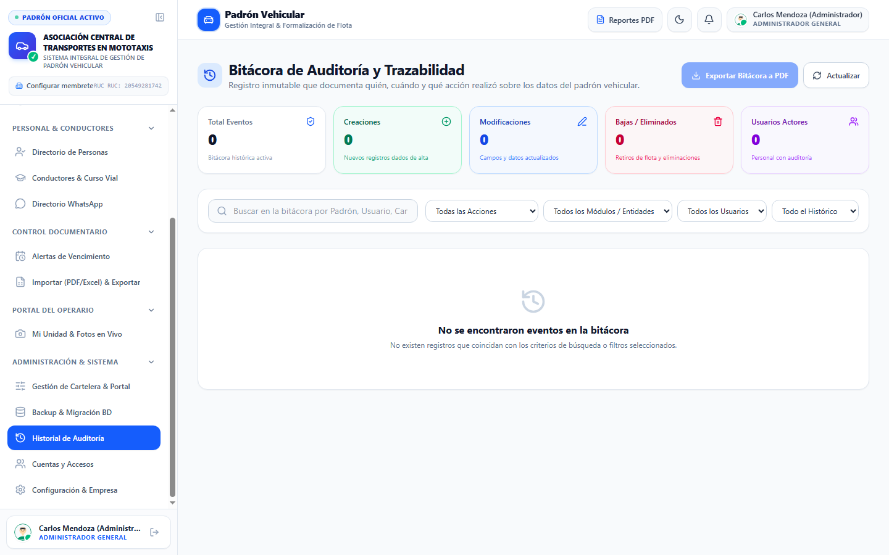 |
| Cuentas y accesos | 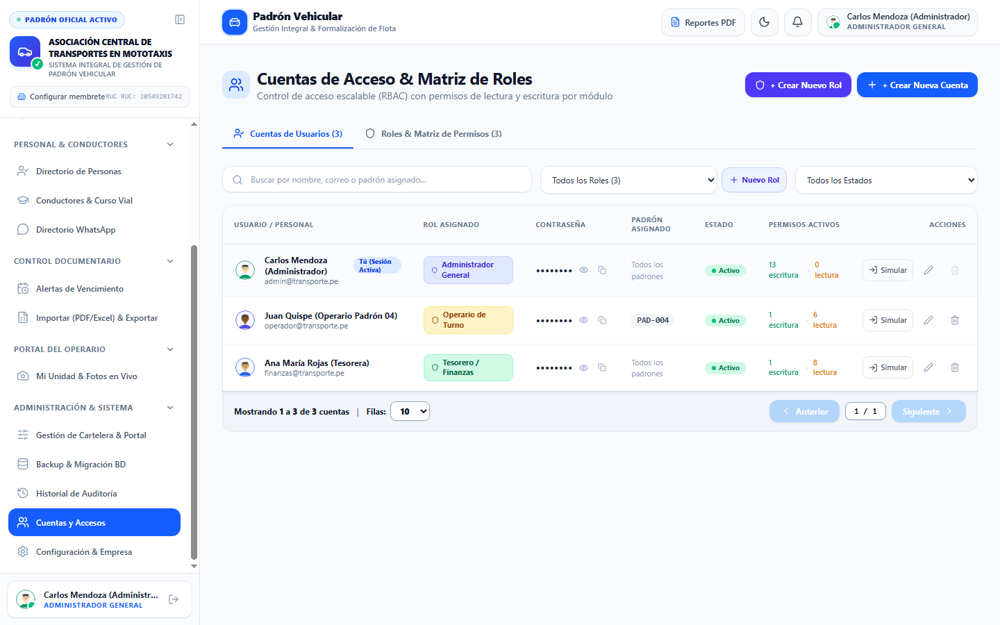 |
| Configuración | 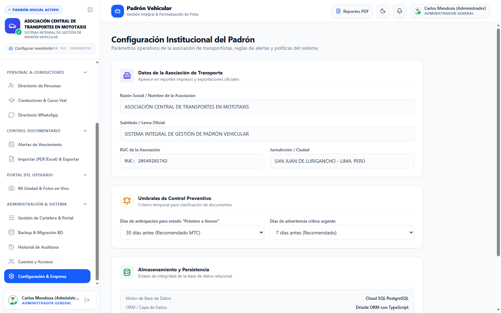 |
| Gestión del portal | 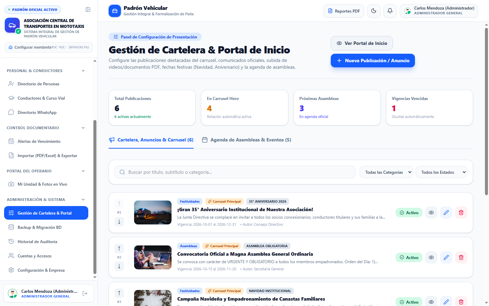 |
| Backup y migración | 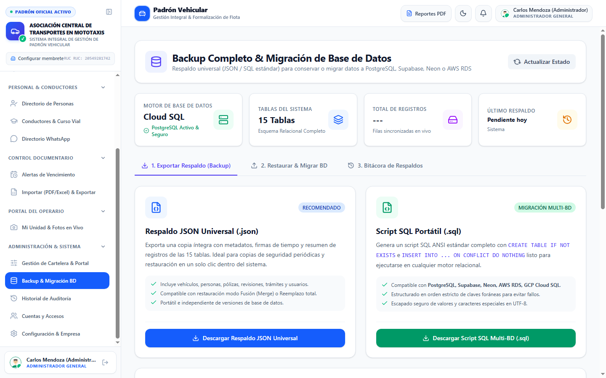 |
| Directorio WhatsApp | 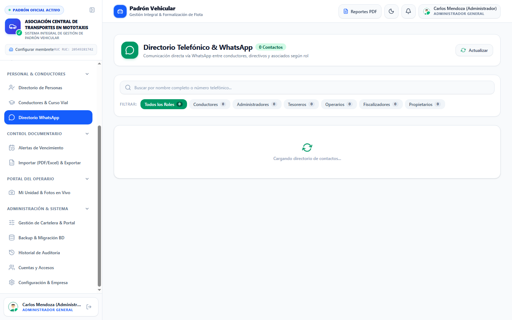 |

---

## 🧩 Módulos

| Módulo | Descripción | Permiso |
| :--- | :--- | :--- |
| **Inicio & Cartelera** | Portal público con carrusel, comunicados, agenda y calendario de eventos. | Lectura |
| **Dashboard estadístico** | Métricas de flota, estados, documentos por vencer y gráficos. | Lectura / Escritura |
| **Padrón vehicular** | Listado maestro, búsqueda, filtros, orden, paginación y ficha detallada. | Lectura / Escritura |
| **Registrar unidad** | Alta de vehículo con placa, motor, propietarios y documentación. | Escritura |
| **Directorio de personas** | Propietarios y conductores con DNI, contacto y ficha. | Lectura / Escritura |
| **Conductores & curso vial** | Carga de actas, cruce por DNI y sincronización masiva. | Lectura / Escritura |
| **Directorio WhatsApp** | Contactos por rol con enlace directo a WhatsApp. | Lectura |
| **Alertas de vencimiento** | SOAT/AFOCAT, CITV, licencias y cursos con semaforización. | Lectura / Escritura |
| **Importar / Exportar** | Importación idempotente desde Excel/PDF y exportación de reportes. | Escritura |
| **Portal del operario** | Vista de “mi unidad” y captura de fotos en vivo. | Escritura |
| **Gestión del portal** | CRUD de publicaciones, eventos y orden del carrusel. | Escritura |
| **Backup & migración** | Exportación JSON/SQL y restauración de la base de datos. | Escritura |
| **Historial de auditoría** | Bitácora inmutable de cambios por entidad y usuario. | Lectura |
| **Cuentas y accesos** | Usuarios, roles y matriz de permisos por módulo. | Escritura |
| **Configuración & empresa** | Datos institucionales, logo y preferencias visuales. | Lectura / Escritura |

### Distribución por roles

`admin`, `developer` (programador/soporte) y `gerente` acceden a **todos** los módulos. El resto de roles solo ve su módulo propio y las lecturas relacionadas:

| Rol | Módulo propio (escritura) | Lecturas relacionadas |
| :--- | :--- | :--- |
| `operator` | Portal del Operario | Inicio, Dashboard, Padrón, Personas, Curso Vial, Vencimientos, Directorio |
| `tesorero` | Importar / Exportar | Inicio, Dashboard, Padrón, Personas, Curso Vial, Vencimientos, Auditoría, Directorio, Configuración, Backup |
| `fiscalizador` | Alertas de Vencimiento | Inicio, Dashboard, Padrón, Personas, Curso Vial, Auditoría, Directorio |
| `secretaria` | Personas, Curso Vial, Directorio, Gestión del Portal | Inicio, Dashboard, Padrón, Vencimientos, Auditoría |
| `registrador` | Registrar Unidad, Padrón, Personas | Inicio, Dashboard, Curso Vial, Vencimientos, Directorio |

La matriz completa y el detalle del RBAC están en [`docs/ROLES.md`](docs/ROLES.md). El backend valida las escrituras con `requireModule`, no solo el menú del frontend.

---

## 🛠 Stack tecnológico

### Frontend
| Tecnología | Uso |
| :--- | :--- |
| **React 19** + **TypeScript 5.8** | Interfaz SPA y tipado estricto. |
| **Vite 6** | Dev server, HMR y build de producción. |
| **Tailwind CSS 4** | Estilos utilitarios y diseño responsive. |
| **Lucide React** | Iconografía. |
| **Recharts** | Gráficos del dashboard. |
| **Leaflet** | Mapas y rutas de vehículos. |
| **Motion** | Animaciones. |
| **SweetAlert2** | Diálogos y notificaciones. |
| **jsPDF + AutoTable** | Generación de PDF. |
| **xlsx (SheetJS)** | Importación/exportación Excel. |

### Backend
| Tecnología | Uso |
| :--- | :--- |
| **Node.js 20+** + **Express 4** | API REST y servidor de la SPA. |
| **tsx** | Ejecución directa de TypeScript en desarrollo. |
| **esbuild** | Empaquetado del servidor para producción. |
| **Drizzle ORM 0.45** | Esquema tipado, consultas y migraciones. |
| **pg (node-postgres)** | Pool de conexiones a PostgreSQL. |
| **Zod 4** | Validación de payloads. |
| **dotenv** | Carga de variables de entorno. |
| **@google/genai** | Procesamiento de documentos con Gemini (opcional). |

### Datos e infraestructura
| Tecnología | Uso |
| :--- | :--- |
| **PostgreSQL 17** | Base de datos relacional principal. |
| **Firebase Auth** | Inicio de sesión con Google (opcional). |
| **Vercel** | Frontend estático / SPA. |
| **Railway / Supabase / Neon** | API y PostgreSQL gestionado (según presupuesto). |

---

## 🏗 Arquitectura

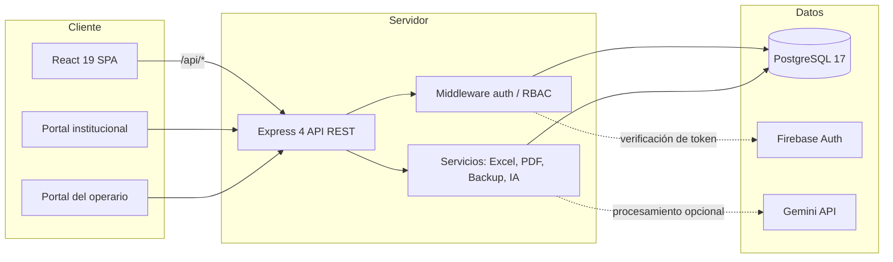

**Patrón:** monolito modular. El frontend y la API comparten tipos y esquema; en desarrollo un único proceso Express sirve la SPA mediante middleware de Vite. En producción Express sirve los archivos estáticos de `dist/`.

### Modelo de datos (resumen)

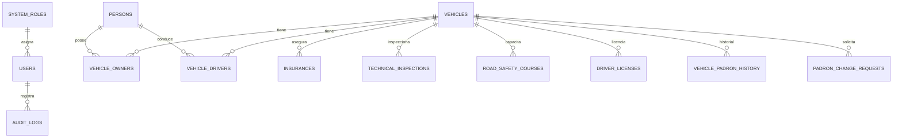

El diagrama completo está en [`docs/DIAGRAMAS.md`](docs/DIAGRAMAS.md).

---

## 📁 Estructura del proyecto

```text
padrón-vehicular/
├── .agents/                 # Instrucciones y convenciones para agentes de IA
├── .github/                 # CI, plantillas de issues/PR y dependabot
├── api-tests/bruno/         # Colección Bruno para probar la API
├── backend/                 # Punto de entrada y re-exports del backend
├── database/
│   └── schema.sql           # Esquema SQL generado desde Drizzle
├── docs/                    # Documentación del proyecto
│   └── screenshots/         # Capturas de los módulos
├── drizzle/                 # Migraciones generadas por drizzle-kit
├── backend/
│   ├── app.ts               # App Express: middlewares, rutas y seed
│   ├── config/              # Variables de entorno y sesión
│   ├── db/                  # Esquema, conexión y consultas Drizzle
│   ├── lib/                 # Firebase Admin
│   ├── middleware/          # Autenticación y RBAC del servidor
│   ├── routes/              # Rutas por dominio (auth, etc.)
│   ├── services/            # Password, tokens y lógica de auth
│   └── utils/               # Excel, PDF, backup, validación
├── shared/                  # Roles, módulos y utilidades compartidas
├── frontend/
│   ├── public/              # Recursos estáticos
│   └── src/
│       ├── api/             # Cliente HTTP
│       ├── components/      # Componentes reutilizables
│       ├── context/         # Auth, tema y estado global
│       ├── hooks/           # Hooks personalizados
│       ├── lib/             # Firebase del cliente
│       ├── types/           # Tipos compartidos
│       ├── utils/           # PDF, alertas y rutas del cliente
│       └── views/           # Vistas por módulo
├── server.ts                # Arranque: Express + Vite/estático
├── index.html               # HTML raíz de la SPA
├── package.json
├── tsconfig.json
├── vite.config.ts
└── .env.example
```

---

## ✅ Requisitos

| Herramienta | Versión mínima | Notas |
| :--- | :--- | :--- |
| **Node.js** | 20 LTS (probado con 24) | Incluye npm. |
| **npm** | 10+ | Gestor oficial del proyecto. |
| **PostgreSQL** | 15+ (probado con 17) | Servicio local o remoto. |
| **Git** | 2.40+ | Control de versiones. |
| **Bruno** | 1.30+ | Opcional, para probar la API. |

---

## 🚀 Instalación rápida

### 1. Clonar el repositorio

```bash
git clone https://github.com/<tu-usuario>/padron-vehicular.git
cd padron-vehicular
```

### 2. Instalar dependencias

```bash
npm install
```

### 3. Crear la base de datos

Con PostgreSQL local en el puerto `5432`:

```bash
# Windows (ruta típica del instalador)
"C:\Program Files\PostgreSQL\17\bin\psql.exe" -U postgres -c "CREATE DATABASE padron_vehicular;"

# Linux / macOS
createdb -U postgres padron_vehicular
```

### 4. Configurar variables de entorno

```bash
# Windows
copy .env.example .env

# Linux / macOS
cp .env.example .env
```

Edita `.env` con tus credenciales reales (ver [Variables de entorno](#-variables-de-entorno)).

### 5. Crear el esquema y datos base

```bash
npm run db:push
```

Esto crea las 15 tablas desde `backend/db/schema.ts`. Los roles, usuarios y contenido base se insertan automáticamente al arrancar por primera vez.

### 6. Arrancar en desarrollo

```bash
npm run dev
```

Abre **http://localhost:3000**.

> Credenciales demo (solo entorno local): `admin@transporte.pe` / `admin123` y `operador@transporte.pe` / `operador123`. La autenticación actual no valida contraseñas; ver [Seguridad](#-seguridad).

---

## 🔐 Variables de entorno

Copia `.env.example` y completa los valores. **Nunca subas tu `.env` real.**

| Variable | Obligatoria | Descripción |
| :--- | :---: | :--- |
| `SQL_HOST` | ✅ | Host de PostgreSQL (`localhost` en desarrollo). |
| `SQL_PORT` | ✅ | Puerto (`5432` por defecto). |
| `SQL_USER` | ✅ | Usuario de la aplicación. |
| `SQL_PASSWORD` | ✅ | Contraseña del usuario. |
| `SQL_DB_NAME` | ✅ | Nombre de la base (`padron_vehicular`). |
| `SQL_SSL` | ❌ | `true` para PostgreSQL gestionado que exija SSL. |
| `SQL_ADMIN_USER` | ❌ | Usuario para `drizzle-kit` (por defecto usa `SQL_USER`). |
| `SQL_ADMIN_PASSWORD` | ❌ | Contraseña para `drizzle-kit` (por defecto usa `SQL_PASSWORD`). |
| `AUTH_DEV_MODE` | ❌ | `true` habilita tokens de desarrollo. En producción debe ser `false`. |
| `JWT_SECRET` | ✅ (prod) | Secreto para firmar sesiones JWT (mínimo 32 caracteres en producción). |
| `JWT_EXPIRES_IN` | ❌ | Duración de la sesión (`8h` por defecto). |
| `AUTH_COOKIE_NAME` | ❌ | Nombre de la cookie de sesión (`padron_session`). |
| `AUTH_COOKIE_SECURE` | ❌ | `true` fuerza cookies `Secure` (HTTPS). En producción se activa solo. |
| `AUTH_COOKIE_SAME_SITE` | ❌ | `lax` (mismo origen) o `none` (dominios distintos, requiere HTTPS). |
| `CORS_ORIGIN` | ❌ | Orígenes permitidos separados por coma. Vacío = mismo origen. |
| `GEMINI_API_KEY` | ❌ | Clave de Google Gemini para funciones de IA. |
| `APP_URL` | ❌ | URL pública de la aplicación. |

---

## 📜 Scripts disponibles

| Comando | Descripción |
| :--- | :--- |
| `npm run dev` | Servidor de desarrollo con Vite y API Express. |
| `npm run build` | Compila la SPA y empaqueta el servidor en `dist/`. |
| `npm start` | Ejecuta el servidor compilado (`dist/server.cjs`). |
| `npm run preview` | Previsualiza el build de Vite. |
| `npm run lint` | Verificación de tipos con TypeScript (`tsc --noEmit`). |
| `npm run smoke` | Smoke test de API y RBAC (requiere `npm run dev`). |
| `npm run db:push` | Aplica el esquema de Drizzle a la base de datos. |
| `npm run db:generate` | Genera una migración SQL desde el esquema. |
| `npm run db:studio` | Abre Drizzle Studio para explorar la base. |
| `npm run db:reset-demo-passwords` | Restablece las contraseñas de las cuentas demo (solo desarrollo). |
| `npm run clean` | Elimina `dist/` y artefactos de build. |

---

## 🗄 Base de datos y migraciones

La **fuente de verdad** del esquema es [`backend/db/schema.ts`](backend/db/schema.ts). El archivo [`database/schema.sql`](database/schema.sql) se genera automáticamente y no debe editarse a mano.

```bash
# Tras cambiar schema.ts
npm run db:generate   # crea drizzle/000X_*.sql
npm run db:push       # aplica los cambios a la base

# Alternativa: ejecutar la migración manualmente
psql -U postgres -d padron_vehicular -f drizzle/0000_*.sql
```

### Tablas principales

`system_roles`, `users`, `persons`, `vehicles`, `vehicle_owners`, `vehicle_drivers`, `insurances`, `technical_inspections`, `road_safety_courses`, `driver_licenses`, `vehicle_padron_history`, `padron_change_requests`, `audit_logs`, `portal_posts`, `portal_events`.

---

## 🧪 Pruebas de API (Bruno)

La colección vive en [`api-tests/bruno/`](api-tests/bruno/):

1. Abre **Bruno** → *Open Collection* → selecciona `api-tests/bruno`.
2. Elige el entorno `local` (`api-tests/bruno/environments/local.bru`).
3. Ejecuta las peticiones: health, vehículos, personas, dashboard, portal y auditoría.

Las peticiones de escritura envían los headers de desarrollo (`Authorization: Bearer dev-admin-token`). Con `AUTH_DEV_MODE=false` debes iniciar sesión con `POST /api/auth/login` y reemplazarlos por el token Bearer devuelto.

> También puedes importar la colección en Postman si lo prefieres; Bruno se eligió por ser *git-friendly* (cada request es un archivo de texto).

---

## ☁️ Despliegue

La arquitectura actual es un **monolito Express** que sirve la SPA. Hay dos caminos:

### Opción A — Recomendada a corto plazo (gratis)
- **Frontend (SPA)** → **Vercel** (`npm run build`, salida `dist/`).
- **API + PostgreSQL** → **Railway** o **Render** (ejecuta `dist/server.cjs`).
- **PostgreSQL gestionado** → **Supabase** o **Neon** (free tier).

### Opción B — Todo en Railway
- Un solo servicio con `npm run build && npm start` y un addon PostgreSQL.

### Opción C — Vercel serverless
- Requiere adaptar `backend/app.ts` a un handler serverless y separar el frontend. Está previsto en el roadmap.

> **Nota:** hoy el frontend llama a `/api/*` en el mismo origen. Para separar frontend y API hay que introducir `VITE_API_URL` y configurar CORS. Está documentado en [`docs/DESPLIEGUE.md`](docs/DESPLIEGUE.md).

---

## 🔒 Seguridad

Antes de publicar el repositorio o desplegar con datos reales, revisa [`SECURITY.md`](SECURITY.md) y [`docs/SEGURIDAD.md`](docs/SEGURIDAD.md). Puntos clave:

- ✅ `.env` y credenciales están excluidos por `.gitignore`.
- ✅ La API verifica la conexión a PostgreSQL al arrancar y falla con un mensaje claro.
- ✅ Autenticación real con argon2id, JWT firmado y cookie `HttpOnly`; los tokens `dev-*` solo existen en desarrollo (`AUTH_DEV_MODE=true` o `NODE_ENV!=production`).
- ✅ Las contraseñas se guardan cifradas con argon2id; las claves heredadas en texto plano se migran al arrancar.
- ✅ `helmet`, CORS configurable y rate limit en el login.
- ⚠️ `firebase-applet-config.json` contiene la configuración pública del SDK web de Firebase. No es un secreto, pero deben configurarse reglas y restricciones de dominio en Firebase.
- ⚠️ En producción define `JWT_SECRET` (mínimo 32 caracteres), `AUTH_DEV_MODE=false` y `AUTH_COOKIE_SECURE=true`.

---

## 🗺 Roadmap

El plan por fases (web, escritorio, móvil, offline y SQLite) está en [`docs/ROADMAP.md`](docs/ROADMAP.md). Resumen:

| Fase | Objetivo |
| :--- | :--- |
| **0. Base** | Repositorio, documentación, CI y despliegue web. |
| **1. Web estable** | Autenticación real, RBAC en servidor, pruebas y accesibilidad. |
| **2. Offline** | Capa de datos local con SQLite y sincronización. |
| **3. Escritorio** | Tauri (recomendado) o Electron con la misma base de código. |
| **4. Móvil** | Capacitor / PWA con cámara y almacenamiento local. |
| **5. Escala** | Observabilidad, backups automáticos y multi-asociación. |

---

## 📚 Documentación

| Documento | Contenido |
| :--- | :--- |
| [`docs/INSTALACION.md`](docs/INSTALACION.md) | Instalación paso a paso y solución de problemas. |
| [`docs/STACK.md`](docs/STACK.md) | Stack, versiones y justificación técnica. |
| [`docs/ARQUITECTURA_SISTEMA.md`](docs/ARQUITECTURA_SISTEMA.md) | Reglas de negocio y arquitectura. |
| [`docs/DIAGRAMAS.md`](docs/DIAGRAMAS.md) | Diagramas Mermaid (arquitectura, ER, flujos). |
| [`docs/API.md`](docs/API.md) | Endpoints de la API REST. |
| [`docs/ROLES.md`](docs/ROLES.md) | Matriz de roles, módulos y RBAC del servidor. |
| [`docs/VERIFICACION.md`](docs/VERIFICACION.md) | Checklist de verificación y smoke test de la Fase 0. |
| [`docs/ROADMAP.md`](docs/ROADMAP.md) | Fases y pendientes. |
| [`docs/DESPLIEGUE.md`](docs/DESPLIEGUE.md) | Vercel, Railway, Supabase/Neon. |
| [`docs/CALIDAD.md`](docs/CALIDAD.md) | Indicadores de calidad y cómo medirlos. |
| [`docs/SEGURIDAD.md`](docs/SEGURIDAD.md) | Modelo de amenazas y deuda técnica. |
| [`docs/TESTING.md`](docs/TESTING.md) | Estrategia de pruebas. |
| [`docs/CONTRIBUCION.md`](docs/CONTRIBUCION.md) | Flujo de trabajo y convenciones. |
| [`AGENTS.md`](AGENTS.md) | Guía para agentes de IA que trabajen en el repo. |

---

## 🤝 Contribuir

Lee [`CONTRIBUTING.md`](CONTRIBUTING.md) y [`docs/CONTRIBUCION.md`](docs/CONTRIBUCION.md). Antes de abrir un PR:

```bash
npm run lint
npm run build
```

Usa mensajes de commit en formato [Conventional Commits](https://www.conventionalcommits.org/).

---

## 📄 Licencia

Licencia **propietaria** (`UNLICENSED`): todos los derechos reservados. El código se publica para consulta y evaluación, pero no se concede permiso de uso, copia, modificación ni distribución sin autorización expresa del titular. La licencia definitiva (por ejemplo MIT o Apache-2.0) se decidirá antes de una distribución pública como software libre.

---

<p align="center">
  Desarrollado para la gestión transparente del transporte público 🚐
</p>
