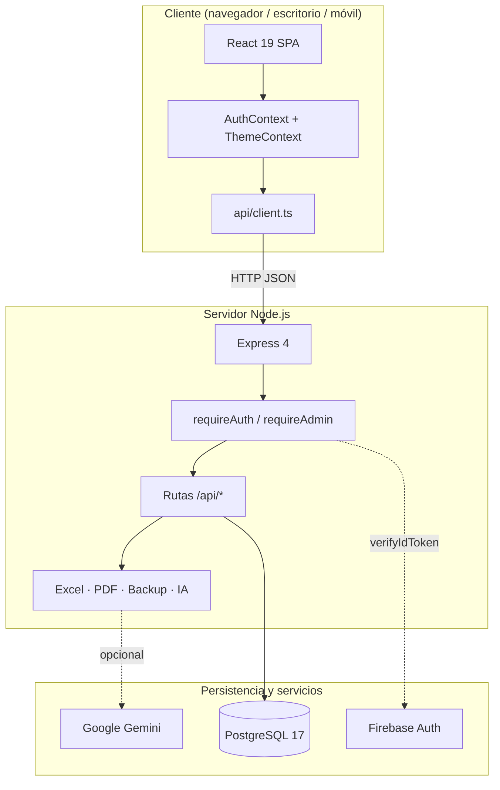
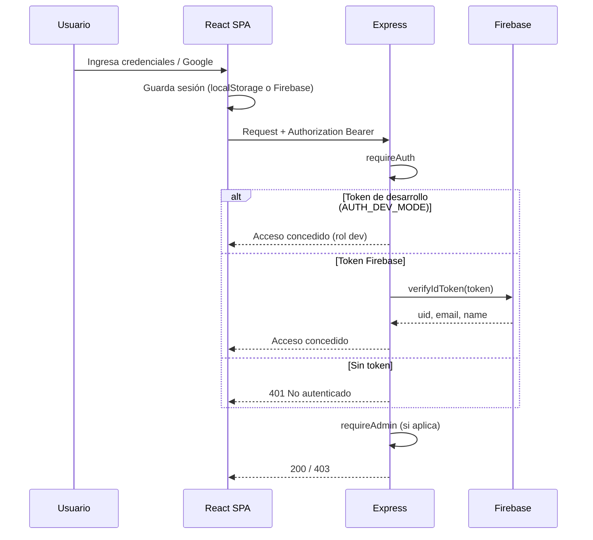
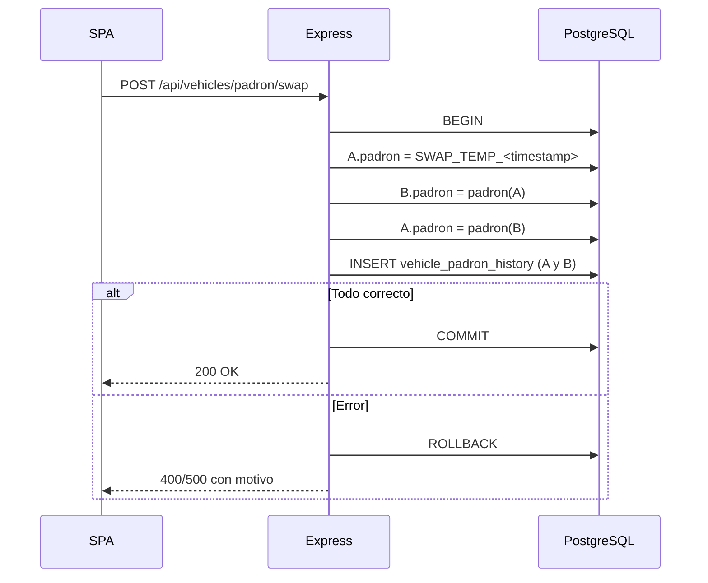
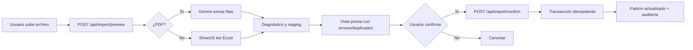
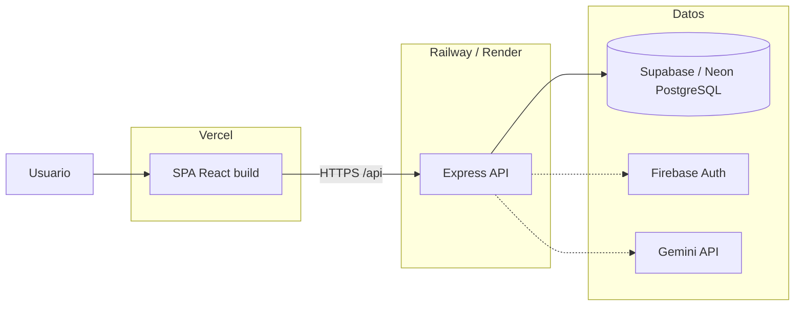

# Diagramas del sistema

Todos los diagramas usan **Mermaid** y se renderizan directamente en GitHub.

---

## 1. Arquitectura general

---

## 2. Modelo entidad-relación

```mermaid
erDiagram
    SYSTEM_ROLES {
        text id PK
        text name
        text permissions
        boolean is_system
    }
    USERS {
        serial id PK
        text uid UK
        text email
        text role FK
        text password
        boolean is_active
    }
    PERSONS {
        serial id PK
        text dni UK
        text full_name
        text phone
        text status
    }
    VEHICLES {
        serial id PK
        text padron_number UK
        text plate UK
        text brand
        int model_year
        text status
        int driver_id FK
    }
    VEHICLE_OWNERS {
        serial id PK
        int vehicle_id FK
        int person_id FK
        boolean is_primary
        boolean is_current
    }
    VEHICLE_DRIVERS {
        serial id PK
        int vehicle_id FK
        int person_id FK
        boolean is_current
    }
    INSURANCES {
        serial id PK
        int vehicle_id FK
        text entity_name
        text expiration_date
    }
    TECHNICAL_INSPECTIONS {
        serial id PK
        int vehicle_id FK
        text expiration_date
    }
    ROAD_SAFETY_COURSES {
        serial id PK
        int vehicle_id FK
        int person_id FK
        text expiration_date
    }
    DRIVER_LICENSES {
        serial id PK
        int vehicle_id FK
        int person_id FK
        text expiration_date
    }
    VEHICLE_PADRON_HISTORY {
        serial id PK
        int vehicle_id FK
        text previous_padron
        text new_padron
        text change_type
    }
    PADRON_CHANGE_REQUESTS {
        serial id PK
        int source_vehicle_id FK
        int target_vehicle_id FK
        text status
    }
    AUDIT_LOGS {
        serial id PK
        text entity
        text action
        text field_name
        text user_email
    }
    PORTAL_POSTS {
        serial id PK
        text title
        text content
        boolean is_active
    }
    PORTAL_EVENTS {
        serial id PK
        text title
        text event_date
        text status
    }

    SYSTEM_ROLES ||--o{ USERS : asigna
    PERSONS ||--o{ VEHICLE_OWNERS : posee
    PERSONS ||--o{ VEHICLE_DRIVERS : conduce
    VEHICLES ||--o{ VEHICLE_OWNERS : tiene
    VEHICLES ||--o{ VEHICLE_DRIVERS : tiene
    VEHICLES ||--o{ INSURANCES : asegura
    VEHICLES ||--o{ TECHNICAL_INSPECTIONS : inspecciona
    VEHICLES ||--o{ ROAD_SAFETY_COURSES : capacita
    VEHICLES ||--o{ DRIVER_LICENSES : licencia
    VEHICLES ||--o{ VEHICLE_PADRON_HISTORY : historial
    VEHICLES ||--o{ PADRON_CHANGE_REQUESTS : solicita
```

---

## 3. Flujo de autenticación

---

## 4. Intercambio transaccional de padrones (SWAP)

---

## 5. Importación de Excel/PDF

---

## 6. Despliegue sugerido

> La separación frontend/API requiere `VITE_API_URL` y CORS. Ver [`DESPLIEGUE.md`](DESPLIEGUE.md).
